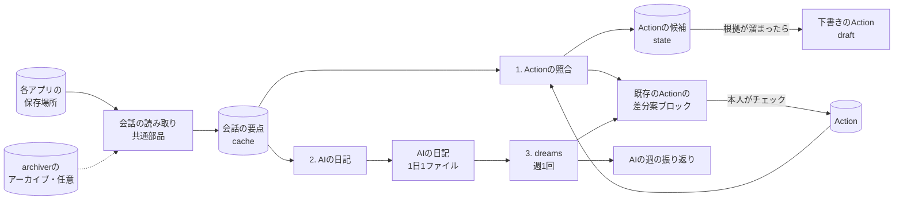

# 役割の作り替え：会話ログから既存ノートへの差分案と、AIの日記を作る

> 設計案（2026-11-04作成、2026-11-06更新）。段階0（14節）は0.48.0で、段階1の前の準備（読む場所の `mode`、会話の要点のcache、根拠ID）は0.50.0で実装した（ノートへの書き込みはまだない）。2026-11-06に、読み込み元の選び方（3.1節）、会話の要点をcacheにすること（3.2節）、前の日・前の週の文脈（5.2節・6.2節）を決めた。名前の統一（11節）は本人が同意し、0.49.0で行った。判断を待つ点は [15節](#15-判断を待つ点) にまとめた。
>
> この文書では、利用者ごとに違うフォルダやファイル名を `<actions_dir>`（作業ノート＝Actionの置き場所）、`<logs_dir>`（本人が書く日次のLogの置き場所）、`<ai_logs_dir>`（AIの日記の置き場所）、`<ai_dreams_dir>`（AIの週の振り返りの置き場所）と書く。実際の値は設定で決める（[12節](#12-ノートの約束を設定で持つ)）。

## 1. なぜ作り替えるか

- 週・月・年のReview Noteは、質問・学び・判断・未解決・洞察・AI改善案を1つのノートに入れようとして長くなり、何に使うノートなのかが定まらなかった。誤りを避ける指示を重ねた結果、文章も慎重で冗長になった。
- Rawの保管は `tkn-genai-chat-archiver` に移った。会話の検索は `tkn-genai-chat-search` が担う。作業の決定・現状の正本はVaultのActionノートで、各AIが作業中に読み書きする。
- 利用者はノートを書く前にAIへの依頼文を書くことが多い。会話には、Actionに書くはずだった内容が多く残っている。
- 一方、Actionは数が多く、進捗の追加・方針の変更・分岐・重複・関係の更新が追いついていない。
- AIが何をして、何がうまくいき、何に失敗したか（資料を探すときのつまずきを含む）は、利用者からは見えていない。

そこで、要約ノートを新しく作るのをやめ、次の2つに役割を絞る。

- **既存のノートへの差分案を少数出す**（Actionの照合）
- **AIの側の記録を、日記と週の振り返りとして本人のノートと分けて残す**（AIの日記・dreams）

AIの日記と週の振り返りは、MetaのAIエージェントMuseの仕組みを参考にした。Museは利用者ごとの仮想マシンにMarkdownの記憶を持ち、日付ごとの日記と、それを振り返って残す学びを選ぶ「dreams」を持つと報告されている（記憶をファイルで持ち、利用者が読み書きできることは公式の説明。dreamsのフォルダ構成は利用者の報告で、公式には確かめていない）。

原則：

1. 決定を推測して要約しない。本人の発言・AIの実施記録など、根拠のある差分だけを出す。
2. 1回に出す差分案は少数（既定5件）とし、本人が採否を決める。採用がゼロの種類はやめる。
3. 根拠と確度はJSONの欄で持ち、文章はプログラムが組み立てる。根拠IDが実在するかはプログラムで確かめる。
4. 既存のノートの本文は、本人が採用するまで変えない。変える候補は、ノートの中の決まった1か所（差分案のブロック）にだけ書く。本人のLogには書かない。昼間に各AIや本人が書いた内容を上書きしない。
5. 利用者ごとに違うもの（フォルダ、ファイル名、Frontmatterの項目、記録の行の形、生成AIの接続先）は設定で持つ。

## 2. 全体の構成

出力先ごとに置き方を分ける。

- **既存のAction**：本文の先頭に「未確認の差分案」のブロックを置き、変更の候補はそこにだけ書く。本人がチェックした項目だけを、次の実行で所定の場所へ移す。どこが変わる・変わったかは、このブロックで分かる。
- **新しいAction**：日をまたいで根拠が溜まった候補だけを、`<actions_dir>` に下書き（`reviewStatus: draft`）として作る。候補を溜める場所はVaultの外（このCLIのstate）。
- **AIの日記**：前日のCodex・Claude Codeの会話から、AIの側の記録を `<ai_logs_dir>` に1日1ファイルで作る。本人のLog（`<logs_dir>`）には書かず、リンクだけを置く。
- **dreams**：週に1回、AIの日記の1週間分を振り返り、残すべき学びの候補を `<ai_dreams_dir>` に作る。候補は、Actionの差分案のブロックへ出す。



| 処理 | 入力 | 出力 | 実行 | 生成AI |
|---|---|---|---|---|
| 会話の要点（共通） | 各アプリの保存場所、またはアーカイブの会話（Codex・Claude Code） | 会話ごとのJSON（作り直せるcache） | 毎日 | 使わない |
| 1. Actionの照合 | 前回以降の会話、対象のAction | 既存のActionの差分案ブロック、下書きのAction | 毎日 | 対応づけの曖昧な分と、差分案の抽出 |
| 2. AIの日記 | 前日の会話の要点、つまずきの数え上げ、関係するAction、前日の日記の持ち越し、最新のdreamsの候補 | `<ai_logs_dir>` の1ファイル | 毎日 | 段階2bから（5.4節） |
| 3. dreams | その週のAIの日記、週の数字、前の週のdreamsと候補の採否、必要なときだけ会話の原文 | `<ai_dreams_dir>` の1ファイル、学びの候補（差分案ブロック） | 週1回 | 使う |

## 3. 共通部分：会話の読み取りと「会話の要点」

### 3.1. 読む場所（2026-11-06に決定）

読む場所は、アプリと取得元ごとに設定の `chat_sources` で選ぶ（2026-11-06に本人が決めた。旧い取得の `sources` は段階4まで別に残るため、名前を分けた。0.50.0で実装し、`archives` を置き換えた）。

| `mode` | 読むもの | 向いている場面 |
|---|---|---|
| `app`（既定） | 各アプリの保存場所（例：`~/.codex`、`~/.claude`）を読み取り専用で読む | 下準備なしで始めたい。archiverを使っていない |
| `archive` | `tkn-genai-chat-archiver` のアーカイブだけを読む | アプリの保存場所が別のPCにある・読めない |
| `auto` | アプリの保存場所を先に読み、そこにない会話（アプリが消した・圧縮で別名になった）はアーカイブから読む | archiverも使っていて、古い会話も確実に読みたい |

- 毎日の処理が読むのは前日の会話なので、ほとんどの場合アプリの保存場所で足りる。アーカイブが要るのは、アプリが古い会話を消した後に読み直すとき（dreamsが原文をたどる、根拠を後で確かめる）だけ。
- `auto` では、同じ会話（アプリ・セッションID）がどちらにもあればアプリの保存場所の方を使う（新しい追記を含むため）。
- `tkn-genai-chat-search`（各アプリのログの読み方）と `tkn-genai-chat-archiver`（アーカイブの読み方）は、どちらもこのCLIの依存ライブラリとして自動で入る。archiverの定期実行や設定が要るのは、`archive`・`auto` を使うときだけ。
- アーカイブを読むときは、その約束（確定したmanifestだけを読む、相対パスごとの最新版を使う、SHA-256を照合する、書き込まない）に従う。どちらの場所も書き込まない。アーカイブは、所有マーカーの `profile`・`sourceId` が設定の `app`・`source_id` と一致するときだけ読む（根拠IDの取得元が混ざらないようにするため）。
- `auto` で「同じ会話」を見分ける単位は会話のファイルとする。Codexはファイル名（`.zst` を除く。圧縮しても `archived_sessions/` へ移しても同じ名前のため）、Claude Codeはプロジェクトのフォルダより下（セッションIDとサブエージェント。作業フォルダの名前を変えるとプロジェクトのフォルダ名が変わるため）で比べる。一方の場所が読めないとき（夜間にWSLが止まっているなど）は、エラーで止めず、もう一方だけを読んでレポートに示す（2026-11-06に本人が決めた）。
- 作業フォルダ（`data_root`・`state_root`・会話の要点のcache）は、Vaultと、`chat_sources` に書いたすべての場所（modeで読まない場所や、無効にした取得元の場所も含む）と重ねない。
- 日時はUTCで記録されることがあるため、設定の時差で現地の日付に直してから使う。

### 3.2. 会話の要点（session digest）

生成AIを使わずに、会話ごとに次をまとめたJSONを作る。3つの処理はこれを読む。

| 欄 | 内容 |
|---|---|
| `sessionRef` | アプリ・取得元ID・セッションID |
| `cwd` / `repo` | 作業フォルダと、その最後のフォルダ名（リポジトリ名）。ドライブ文字の違いやジャンクションは、設定の `path_aliases` で同じものとして扱う |
| `title` | 会話のタイトル（アプリが付けたもの・本人が付けたもの） |
| `kind` | `main`・`subagent`・`review` |
| `userRequests` | 本人の発言（3.3節）。根拠ID・日時・本文・貼り付けかどうか |
| `assistantFinals` | 各ターンの最後のAIの回答。根拠ID・日時・本文（長さを制限） |
| `toolEvents` | ツール実行。根拠ID・日時・ツール名・分類（読む・探す・一覧・編集・実行・Web・Skill・その他）・対象（パス・検索語）・成否・失敗の種類・結果の大きさ |
| `vaultTouches` | 会話中に開いた・変えたVaultのノート（Action・Logなど） |
| `facts` | 機械的に分かる実施の事実（commitのハッシュ、書いたファイル、登録した定期実行など） |
| `coverage` | 読めなかった行、知らない記録の種類の件数 |

扱い（2026-11-06に決定）：

- 会話の要点は、3つの処理が同じ下ごしらえ（本人の発言の選別、ツール実行の組、事実の抽出）を繰り返さないための途中の形である。処理の間の約束や、残すデータにはしない。
- 保存する場合は、作り直せるcacheとして `<cache_root>/digests/` に置く（0.48.0・0.49.0は `<data_root>/digests/` に置いていた。0.50.0で移した）。会話の内容のSHA-256・設定・版が変わったら作り直す。消してもよく、`digests.cache: false` で保存しないこともできる。1回の実行で同じ内容のファイルが2つあれば（`.jsonl` と `.jsonl.zst`、`auto` の両方の場所）、1回だけ作る。
- 要点の `file`（アプリ・取得元ID・相対パス・内容のSHA-256・行数）は内容だけで決まり、どちらの場所から読んだかは `location` に分けて持つ。同じ内容なら、アーカイブから作ったcacheをアプリの保存場所から読んだときにも使える。Codexのタイトルは会話の外（`session_index.jsonl`）にあるので、そのスレッドの名前が変わったとき（場所によって違うときを含む）も作り直す。
- SQLiteにはしない。件数は数千件で、1件ずつのJSONで足りる。人がそのまま開いて、生成AIに何を渡したかを確かめられる。日付や作業フォルダで会話を絞るのが遅くなったら、そのときに小さな索引（作り直せるもの）を足す。
- 生成AIに渡した入力と返った出力は、処理ごとの実行記録（`state_root/runs/`）に残す。会話の要点を後から確かめるのに使う。

### 3.3. 「本人の発言」の判定

`決定（本人）` の根拠になるため、ここを厳しくする。

- Codex：`role: user` の発言から、Codexが付け足すAGENTS.mdの指示・環境情報を除く（`tkn-genai-chat-search` と同じ規則）。`review`・`subagent` の会話は対象外。
- Claude Code：`type: user` の発言のうち、次を除く。
  - `<system-reminder>` の部分と、それだけの発言
  - `isMeta`・`isCompactSummary`・`isSidechain` の発言
  - `turnOrigin` が `human` でない発言（例：`sdk`）。別のセッションから渡された依頼文や通知がこれに当たる。古い記録でこの欄がない発言は本人の発言として扱うが、確度を1段下げる
  - ツール結果だけの発言（`tool_result`）
- 貼り付け（`<pasted_content>`）は本人の発言に含める。利用者は依頼文を別の場所で書いて貼ることが多いため。ただし、発言の一部だけが貼り付けで、その部分から決定を引用する場合は確度を下げる（他人の文章やログの可能性があるため）。

### 3.4. 根拠ID

`<app>/<source_id>/<session_id>@<内容のSHA-256の先頭12桁>#L<行>` の形とする（0.50.0で実装）。

- SHA-256は、展開した後の内容のもの。Codexが `.jsonl` を `.jsonl.zst` に圧縮しても、アプリの保存場所から読んでもアーカイブから読んでも、同じ内容なら同じIDになる。
- プログラムは、IDの内容が読める場所にあり、SHA-256が一致し、その行が会話の要点の中にあることを確かめる。存在しないIDを含む差分案は捨て、件数を記録する。
- `app` だけで読む場合、アプリが後で会話を消したり書き換えたりすると、古い根拠は確かめられなくなる。後から確かめたい場合は `auto` を使う。
- IDの確かめ（存在しないIDを含む差分案を捨てる）は、段階1で差分案を作るときに入れる。
- ノートに書く行の「根拠」には `<アプリ名> <セッションID>` だけを書く。版と行は差分案のJSONに残す。

### 3.5. 前回の続きから読む

- 会話ごとに「どの内容（SHA-256）の何行目まで処理したか」と、処理した部分の長さを `state_root` に残す。
- 今の内容が、処理した部分で始まっていれば（追記）、続きだけを読む。アーカイブでは `previous.relation: appended` も使える。そうでなければ（書き換え）会話全体を読み直し、出し済みの差分案と重複しないようにする。

### 3.6. Actionの読み取り

- `<actions_dir>` 以下のMarkdownを直接読む（夜間にObsidianを起動しないため）。件数は数千件程度なので、DBや索引は作らない。
- 読むもの（項目名と見出しは設定で決める）：Frontmatter（ID・title・status・更新日時・確認の状態・生成者・関係の項目・任意の `aliases`・`repositories`）、作業の項目（未チェックのチェックボックス）、Notesの記録の行（日付・種類・主体・結論・根拠）、差分案のブロック（4.6節）。
- Notesの根拠にあるセッションIDから、「どの会話がすでにどのActionに記録されたか」の索引を実行のたびに作る。

## 4. 処理1：Actionの照合

### 4.1. 対象

- 会話：前回の実行以降の新しいターン。最初の実行だけ直近14日分。`main` の会話だけを読み、サブエージェントの作業は親の会話の `facts` に含める。
- Action：
  - 段階1では、statusが「作業中」のActionと、直近14日に更新日時が変わったAction
  - 会話中に開かれた・変えられたActionは、statusにかかわらず対象に加える
  - 新しいActionの候補との重複を調べるときは、終了していないAction（下書きを含む）すべてと比べる

### 4.2. 会話とActionの対応づけ

まずプログラムで手がかりを集め、それで決まらない分だけ生成AIに選ばせる。

| 手がかり | 強さ | 内容 |
|---|---|---|
| A. 会話中にActionを開いた・変えた | 強（コマンドの引数に出ただけなら弱） | `toolEvents` に `<actions_dir>` 以下のパスがある。各AIが作業の始めにActionを読む運用なら、これが主な手がかりになる。検索・一覧のコマンドで出たファイルは「読んだ」に数える |
| B. Actionの根拠にこの会話がある | 強 | Notesの根拠にこのセッションIDがある。会話中に書かれた行と重複させないためにも使う |
| C. 本人の発言にActionの名前がある | 強 | WikiLink・ファイル名・title・`aliases` の一致 |
| D. 作業フォルダのリポジトリ名がActionにある | 中 | `repositories` の値、なければtitleに含まれるリポジトリ名。1件だけ一致すれば対応づける |
| E. 言葉の近さ | 弱 | 本人の発言と、title・description・nouns・未チェックの項目との文字n-gramの近さ。上位3件だけを候補にする |

決め方：

1. A・B・Cのどれかがあれば、そのActionに対応づける（複数あれば複数）。ただし、Aがコマンドの引数にファイル名が出ただけ（A(実行)）のときは、それだけでは対応づけない。同じActionにほかの手がかりがあるときだけ使う。`git add` や一括処理のスクリプトの引数に出ただけでは、その会話がそのActionの作業をしたとは言えないため（段階0の試行で誤りの多くがこれだった。2026-11-06）。
2. なければ、Dが1件だけならそれに対応づける。
3. Dが複数、またはEだけのときは、候補（最大3件）を生成AIに示し、どれか1つか「どれでもない」を選ばせる。候補にないIDは選べない。
4. どれにも対応しない会話で、作業フォルダの名前が終了したActionの `repositories`（なければtitle）に一致するものは「続き」とする。titleで比べるのは、`_` か `-` を含む名前だけにする（`windows` のような普通の語が、終了した多くのActionのtitleに当たるため）。「続き」は、そのActionを再開する差分案にせず、新しいActionの候補に足す（4.7節。2026-11-06）。
5. 「どれでもない」となり、本人の依頼に作業の実体がある会話は、新しいActionの候補に足す（4.7節）。

結果は `links.jsonl` に、手がかりと決め方とともに残す。誤った対応づけを後から調べられるようにするため。対応づけの結果は、AIの日記（5節）でも使う。

### 4.3. 既存のActionへの差分案の種類

| 種類 | 反映する場所 | 内容 | プログラムの確認 |
|---|---|---|---|
| `decision` | Notesの末尾に1行 | 既定：`- YYYY-MM-DD 決定（本人。<処理名>が抽出）：<結論>。根拠：<アプリ名> <ID>` | 本人の発言からの引用（`userQuote`）が、根拠の発言に文字どおりある |
| `done` | 同上 | 既定：`- YYYY-MM-DD 実施（<AI名>。<処理名>が抽出）：<結論>。根拠：…` | 根拠がツール実行かAIの回答で、`facts` と食い違わない |
| `check` | 同上 | 既定：`- YYYY-MM-DD 確認（本人。<処理名>が抽出）：<結論>。根拠：…` | 本人の発言からの引用がある |
| `status` | Frontmatterのstatus・着手日 | 例：未着手のActionで作業が始まった → 作業中、着手日を設定 | 根拠の会話で、そのActionの作業の実体がある |
| `relation` | 関係の項目 | 例：親のActionへのリンクを足す | 両方のActionが実在する |
| `task` | 作業の項目 | チェックボックスを1つ足す（dreamsの学びの候補など。6.4節） | 根拠がある |
| `duplicate`・`split` | 両方のActionのNotes | 重複・分岐の指摘。採用されたら両方に本人の決定の行を足す。statusの変更は別の項目として出す | 両方のActionが実在する |

- 行の形（種類の名前・主体の書き方・区切りの記号）は設定のテンプレートで変えられる。上は同梱する日本語の既定。
- 日付は、根拠の発言の日付（現地時間）とする。実行した日ではない。
- `提案` の行は段階1では作らない。AIの勧めは数が多く、すぐ埋まるため。
- 会話中にAIがすでに書いた行（同じセッションID・同じ種類・近い結論）があれば出さない。

### 4.4. 生成AIへの入力と出力

対応づいたActionごとに1回呼ぶ（そのActionに対応づいた新しいターンをまとめて渡す）。

入力：

- Actionの要約：title・status・未チェックの項目・Notesの最後の10行・差分案のブロックにある未判定の項目
- 対応づいたターン：本人の発言（上限あり）、各ターンの最後のAIの回答（上限あり）、`facts`
- それぞれの根拠ID

出力（JSON。schemaで縛る）：

```json
{
  "proposals": [
    {
      "kind": "decision",
      "actionId": "<noteId>",
      "conclusion": "期間ごとのレビューをやめ、出力先ごとに処理を分ける",
      "evidenceIds": ["claude-code/my-pc-windows/<session-id>@<sha12>#L120"],
      "userQuote": "出力先ごとに処理を分ける",
      "confidence": "high",
      "alreadyRecorded": false
    }
  ],
  "newActionCandidates": [
    {
      "title": "<動詞で終わる短いtitle>",
      "evidenceIds": ["..."],
      "userQuote": "<作業する意思を示す本人の発言>",
      "parentCandidateIds": ["<noteId>"]
    }
  ]
}
```

- `conclusion` は80文字以内、改行なし、句点なし。本人の言葉に近く書かせる。
- 理由や留保の文章は書かせない。確度は `high`・`medium`・`low` の3段階だけ。
- 出力が契約に合わなければ1回だけ直させる。それでも合わなければ捨てて記録する。
- 1回の実行の呼び出し回数に上限を設ける（例：10回）。超えた分は次回に回す。

### 4.5. 並べ方と上限

- 順位：手がかりの強さ × 確度。同じなら `decision` > `done` > `status` > `check` > `relation` > `task` > `duplicate`・`split`。新しいActionの下書きも同じ枠に入れる。
- 1回の実行で新しく出すのは既定5件（ブロックの項目と下書きのActionの合計）。残りはJSONに残す。
- 1つのActionのブロックに置く未判定の項目は既定5件まで。
- 未判定の項目と、判定されていない下書きのActionが合わせて既定10件以上あれば、新しい差分案を出さない。溜まる場所を増やさないため。
- 30日たっても判定のない項目はブロックから外し、「無反応」として数える。外した項目はstateに残し、同じ根拠でまた出すことはしない。

### 4.6. 差分案のブロック（既存のAction）

既存のActionへの変更の候補は、本文の先頭（Frontmatterの直後）に置く1つのcalloutにだけ書く。

```markdown
> [!ai-proposal] 未確認の差分案（<処理名>、2件）本人の判定前。決定として扱わない
> - [ ] Notesに足す：2026-11-04 決定（本人。<処理名>が抽出）：期間ごとのレビューをやめ、出力先ごとに処理を分ける。根拠：Claude Code <session-id>
>     - 根拠：「…出力先ごとに処理を分ける…」（本人、11-04 14:52）／確度：高（会話中にこのActionを開いた。引用が一致）／P-20261105-01
> - [ ] statusを変える：NotStarted → InProgress、startedを 2026-11-03 にする
>     - 根拠：Claude Code <session-id> でこのActionの作業をした（commit 2件）／確度：高／P-20261105-02
```

判定のしかた：

| 本人の操作 | 意味 |
|---|---|
| チェックを付ける | 採用。次の実行で、項目に書いた場所へ移す |
| 内容を書き換えてからチェックを付ける | 修正して採用。書き換えた内容で移す |
| 項目を消す | 却下 |
| 理由を残したいとき：行頭を `- [-]` にし、後ろに理由を書く | 理由付きの却下（`誤り`・`不要`・`重複`・`粒度`・`記録済み`） |
| そのままにする | 未判定（30日で外す） |

ブロックの扱い：

- ブロックの範囲（calloutの行）が、そのActionで「これから変わるかもしれない部分」のすべてになる。採用されて移った内容は、本人がチェックした項目そのものなので、Gitの差分を見なくても何が変わったか分かる。
- 項目は日をまたいで溜まり、同じ内容（同じ種類・近い結論）は1つにまとめる。テーマが何日も続いても、差分案はそのAction1か所に集まる。
- 項目の末尾のID（`P-…`）で、判定と差分案を対応づける。ブロックの形が崩れて読めないときは、ブロックに触らずに報告する。
- 項目がなくなったら、ブロックごと消す。
- calloutの種類名・見出しの文言・置く位置は設定で変えられる。
- Vaultでタスクを集める一覧を使っている場合、ブロックのチェックボックスがそこに集まることがある。必要ならその一覧の条件で除く。

ほかのAIとの約束（利用者のVault側の規則に置く）：

- `ai-proposal` のブロックの中身は本人の判定前で、決定・現状として扱わない。
- ほかのAIはブロックを書き換えたり消したりしない（本人とこのCLIだけが変える）。

判定待ちのActionの見つけ方：

- ブロックを足したActionは、確認の状態を「未確認」（既定 `unreviewed`）にする。
- 件数で並べたい場合は、Frontmatterに未判定の件数（例：`aiProposals: 2`）を持たせる（13節。任意）。

### 4.7. 新しいAction（下書き）

候補を溜める：

- 既存のActionに対応づかない会話の作業や、`newActionCandidates` は、すぐにはActionにせず、`state_root/action-candidates.json` に溜める。候補ごとに、根拠の会話・日付・`facts`・本人の発言を足していく。
- 終了したActionのリポジトリでの続きの作業（4.2節の「続き」）も、ここに溜める。終了したActionは期待した成果を得て終わったものなので、再開せず、新しいActionにする。下書きを作るときは、その終了したActionを、前のActionとして根拠の行に示す。
- 次のどれかを満たした候補だけを、下書きのActionにする。
  1. 2日以上の別々の日の会話に出てきた
  2. 作業の実体がある（commit、ファイルの作成、定期実行の登録など）
  3. 本人が会話の中で「やる」「作る」とはっきり言った（引用が発言に文字どおりある）
- 作る前に、終了していないAction（このCLIが作った下書きを含む）と、title・リポジトリ名・`aliases` で比べる。近いものがあれば、新しく作らず、そのActionへの差分案（`relation` や `decision`）に回す。

下書きの形：

- 設定のテンプレート、または設定したコマンド（利用者のVaultのFrontmatter処理など）で作る。ファイル名の形も設定に従う。
- Frontmatter：確認の状態は `draft`、生成者は `<処理名> (<モデル名>)`。statusは事実から決める（作業の実体があれば作業中と着手日、なければ未着手）。親の候補が確かなら関係の項目に入れる。
- 本文：Contextには本人の発言の引用だけを置く（AIの説明文は入れない）。Notesには根拠付きの記録の行を置く。
- 新しいファイル全体が下書きなので、差分案のブロックは使わない。

判定のしかた：

| 本人の操作 | 意味 |
|---|---|
| 確認の状態を `draft` 以外にする | 採用。以後は普通のActionとして扱う |
| ファイルを消す、またはstatusを終了（例：`Closed`）にする | 却下。同じ根拠で作り直さない |
| そのままにする | 未判定。上限（4.5節）に数える |

判定待ちの下書きは、「確認の状態が `draft` で、生成者がこのCLI」という条件の一覧（Obsidian Basesなど）で見つける。

### 4.8. ノートへの書き込み

1. 採用前に変えるのは、既存のActionでは差分案のブロックと、確認の状態・更新日時（・任意の件数の項目）だけ。ブロックの外の本文は、本人が採用した項目を移すときにしか変えない。
2. 採用された項目は、項目に書いた場所へ移す。Notesの行は、Notesの中の最後の記録の行の後に足す（記録の行がなければNotesの最後、成果物の節の前）。移したらブロックから消す。
3. Notesの行以外を変えたとき（status・関係の項目・作業の項目）は、同じ編集で `実施（<処理名>）` の行を足し、変えた場所を書く。
4. 本人が採用した項目を移すときは、確認の状態を変えない（本人が確認済みのため）。ブロックに新しい項目を足したときは「未確認」にする。
5. 書く前に読んだ内容のSHA-256を残す。書く直前に読み直して比べ、変わっていたら計画をやり直す（1回まで）。それでも変わるなら次回に回す。置き換えは一時ファイルからの置き換えで行う。
6. 最後の変更から30分以内のファイルと、直近60分に動いていた会話が開いた・変えたActionは、次回に回す。その会話のAIや本人が書いている最中かもしれないため。
7. 同じセッションIDを根拠にした、同じ種類の近い結論の行がすでにあれば、出さない・移さない。
8. Frontmatterは対象の行だけを書き換える（YAML全体を書き直さない）。改行コードとBOMは元のままにする。
9. 書いた内容を `state_root/applied.jsonl` に残す（ファイル・ID・項目・前後のSHA-256）。commitはしない。
10. この処理は同時に1つしか動かない（ロック）。

AIの日記とdreamsは、このCLIが作る新しいファイルなので、5・6の照合だけを使う（5.5節）。

### 4.9. 直接書く方式へ移る条件

差分案の種類ごとに判定する。

| 条件 | 内容 |
|---|---|
| 件数 | 判定済みが20件以上、期間が14日以上 |
| 採用率 | そのままの採用が90%以上（無反応も分母に入れる） |
| 誤り | 直近10件に理由「誤り」の却下がない |
| 本人の決定 | 本人が移ると決め、そのことをActionに記録している |

- 直接書く方式では、行をNotesなどの所定の場所に直接書き、行の末尾にブロックID（例：`^gcn-20261105-01`）を付ける。差分案のブロックには「直接書いた行（確認だけ）」としてその行へのリンクを並べ、チェックボックスは付けない。本人が確認したらリンクの項目を消す（確認の状態を `accepted` にしたら、このCLIが消す）。
- このCLIが書いた行は、主体の「<処理名>が抽出」とブロックIDで見分けられる。Gitの差分を見なくても、どの行を書いたかが分かる。
- 直接書いた行を本人が消した・書き換えたことを次回に見つけたら、却下として数える（整形ツールによる空白などの違いは無視する）。14日に2件以上あれば差分案の方式に戻す。
- 止める条件：差分案が5件以上あって2週続けて採用が0件、または判定済み20件で採用率30%未満の種類は出すのをやめ、その旨をActionに記録する。
- `duplicate`・`split`・`status`（終了にするもの）は直接書く方式に移さない（Actionを閉じる判断を含むため）。

### 4.10. 実行のタイミング

毎日、archiverの後（例：archiverが02:00なら04:00）。順番は次のとおり。

1. 各Actionのブロックと下書きのActionから、判定を読む
2. 採用された項目を移す。却下・期限切れを記録する
3. 新しい会話を対応づけ、差分案と候補を作る
4. 条件を満たした候補から下書きのActionを作る
5. ブロックに新しい項目を足す
6. 前日のAIの日記を作る（5節）。週の初めの日は、前の週のdreamsも作る（6節）

## 5. 処理2：AIの日記

### 5.1. 役割

- 生成AIの作業を、AIの側から日ごとに記録する。本人が書くLog（`<logs_dir>`）とは分ける。本人のLogは1日1ファイルで本人が自由に書くノートであり、このCLIは書き込まない。
- 主な読み手はAI（次の作業をするAIと、dreams）。人が読んでも分かる書き方にするが、読み手を混ぜない。以前の期間レビューは、人とAIの両方に向け、1つのノートに多くの役割を持たせたことが問題だった。
- 役割は「その日、AIが何をして、何がうまくいき、何に失敗し、本人から何を学んだか」の記録に絞る。作業の決定・現状の正本はActionであり、決定は差分案（4節）として扱う。
- 対象は、記録が取れる生成AIの会話（現在はCodexとClaude Code）。各項目の主語は、その作業をしたAI（例：「Claude Codeが…」）とする。

### 5.2. 入力（2026-11-06に決定）

その日の材料：

- 前日（現地時間）の会話の要点（3.2節）。`main` の会話を中心に、サブエージェントのツール実行も数える。
- つまずきの数え上げ（5.3節）。

文脈（根拠にはしない）：

- 処理1で対応づいたActionの要約：title・status・Goalの最初の数行・Notesの最後の5行。作業が何のためか、どこまで進んでいたかの長い文脈は、Actionが持つ。
- 前日のAIの日記の「持ち越し」の節だけ。昨日の続きの作業を「続き」と書けるようにするため。
- 最新のdreamsの「残すべき学びの候補」の見出しだけ。同じつまずきを繰り返したかに気づけるようにするため。

決まり：

- 日記の各項目の根拠は、その日の会話だけにする。前日の日記やdreamsの内容を、その日の出来事として書き写さない。
- 前日の「持ち越し」は、その日の会話で触れたものだけを書く（進んだ・終わった・まだ残る）。触れなかったものは書き写さず、前日の日記に残す。毎日同じ項目が増え続けないようにするため。
- 文脈の量に上限を設ける（例：合わせて日本語3,000文字）。

### 5.3. 生成AIを使わずに数えるもの

会話ごと（サブエージェントを含む）に数え、`<data_root>/ai-logs/metrics/` に残す。日記の「うまくいかなかったこと」と、dreamsの入力に使う。

| 指標 | 内容 |
|---|---|
| 資料を探した回数 | 読む・探す・一覧のツール実行。シェルの `cat`・`rg`・`ls`・`Get-Content` なども分類する |
| 開いた入口 | 最初の数回で開いたファイル（設定した指示ファイル・spec・README・Action） |
| 読み込みの失敗 | ファイルがない・パスの形の誤り・権限・文字コードなど。種類ごと |
| 本人の拒否 | 本人が許可しなかったツール実行。失敗とは別に数える |
| 本人の訂正 | 本人が直前の回答ややり方を否定・訂正した発言（「違う」「そうではなく」などの手がかりで候補を拾い、段階2bで生成AIが確かめる） |
| 検索の繰り返し | 同じ検索語・ほぼ同じ検索語の2回目以降 |
| 読み直し | 同じファイルを3回以上読んだ |
| 着くまでの手数 | 最初に編集したファイル、または対応づいたActionを開くまでの、資料を探した回数 |
| 広すぎる走査 | 深さを限らない一覧・検索、切り詰められた大きな結果 |
| Actionの規則の守り方 | 始めにActionを読んだか。commit・ファイル作成などの後にNotesに行を足したか。行の形が規則どおりか |

最後の行は、Actionを作業の決定・現状の正本にする試行の評価に使う（AIごと・週ごとの割合）。

### 5.4. 出力

ファイル：`<ai_logs_dir>/<西暦>/<YYYY-MM-DD> AI.md`（名前の形は設定）。本人のLogと同じ名前にしない（Vault全体で同名を避け、`[[YYYY-MM-DD]]` が本人のLogだけを指すようにするため）。

```markdown
---
type: aiLog
title: "2026-11-05 AI"
actions: ["[[<Action A>]]"]
generator: "<処理名> (<モデル名>)"
reviewStatus: unreviewed
---

本人のLog：[[2026-11-05]]

## 今日やったこと

- Claude Code「<会話のタイトル>」：<作業の短い説明>（[[<Action A>]]、Claude Code <session-id>）
- Codex「<会話のタイトル>」：<作業の短い説明>（Codex <session-id>）

## うまくいったこと

- <短い説明>（Claude Code <session-id>）

## うまくいかなかったこと

- <短い説明>（Codex <session-id>）
- 資料探し：読み込みの失敗 8件（ファイルがない 6件）、同じ検索の繰り返し 4件、始めにActionを読まなかった会話 2件

## 本人から学んだこと

- <本人の訂正・好み・却下から分かったこと>（Claude Code <session-id>）

## 持ち越し

- <終わらなかった作業・本人の判断待ち>（[[<Action A>]]）
```

- 節は固定する。書くことのない節は「なし」とする。
- 各項目は1〜2文で、根拠（`<アプリ名> <セッションID>`）を付ける。関係するActionへリンクする。全体の長さに上限を設ける（例：日本語2,000文字）。
- 本人の言葉を引くときは、発言にある文字列だけを使う。
- 会話に出た他人について、人物ごとの記録やプロファイルを作らない。名前は会話にあったとおりにだけ書く。APIキーやトークンらしい文字列は伏せる。
- 会話のない日は作らない。

作り方：

- 段階2a（生成AIなし）：「今日やったこと」は会話ごとにタイトル・作業フォルダ・対応づいたAction、「うまくいかなかったこと」は5.3節の数字だけを並べる。ほかの節は空にする。
- 段階2b（生成AIあり）：会話の要点と数字を渡し、各節の項目をJSONで返させる（節・本文120文字以内・根拠ID・引用）。プログラムが根拠IDと引用を確かめて、Markdownを組み立てる。

### 5.5. 更新と評価

- 前日の分を毎日作る。後から同じ日の会話が届いたとき、ノートが本人に変えられていなければ作り直し、変えられていれば作り直さずに末尾に `## 追加（<日時>）` として足す。
- 書き込みは4.8節の5・6（書く直前の照合、30分の待ち）を使う。
- 7日後に、日記が読まれたか（Obsidianで開いた記録は取れないため、本人が手を入れた・リンクした・dreamsの候補が採用された、で代える）を数え、役に立っているかの目安にする。

## 6. 処理3：dreams（週の振り返り）

### 6.1. 役割

- AIの日記の1週間分を振り返り、次の作業でも残すべき学びを選ぶ。週の出来事のまとめではない。
- Museの「dreams」に倣う。日々の記録から、長く残す記憶へ移すものを選ぶ処理と考える。このVaultで「長く残す記憶」に当たるのは、AIのやり方を決める指示ファイル（AGENTS.md・CLAUDE.md・Skill・spec）、作業の状態（Action）、本人についてのノート（設定で指定）。
- 主な読み手はAI。役割は「繰り返したことと、残すべき学びを選ぶ」ことに絞る。

### 6.2. 入力（2026-11-06に決定）

- その週（月曜〜日曜）のAIの日記7日分。
- 週の数字：5.3節の指標の週の合計と前週との比較、差分案の種類ごとの採用率。
- つまずきの大きい会話（失敗・繰り返し・手数の多さで点数を付けた上位5件）の、ツール実行の並び（ツール名・対象・成否・失敗の最初の200文字）。
- 前の週のdreamsと、その「残すべき学びの候補」の採否（採用・却下・無反応。`judgments.jsonl` から）。採用した学びの後に同じつまずきが減ったかを確かめ、却下された候補を出し直さないため。

原文をたどる（必要なときだけ）：

- 日記の要約だけでは原因が分からないときは、生成AIが、その週の日記が引いた根拠IDの中から最大5件を求めてよい。プログラムが該当する発言・ツール実行とその前後を、合わせて日本語8,000文字まで取り出して渡す。求められるのは1回だけ。
- 日記が引いていない会話や、任意のパスは読ませない。取り出した原文は、dreamsの根拠として会話の根拠IDで示す。

### 6.3. 出力

ファイル：`<ai_dreams_dir>/<ISO週の西暦>/<YYYY-Www> AI.md`（名前の形は設定）。

```markdown
---
type: aiDream
title: "2026-W45 AI"
aiLogs: ["[[2026-11-02 AI]]", "..."]
generator: "<処理名> (<モデル名>)"
reviewStatus: unreviewed
---

## 繰り返したつまずきとその原因

- <つまずき>：<原因の分類>（[[2026-11-03 AI]]、[[2026-11-05 AI]]）

## 本人について分かったこと（推測）

- <好み・判断の傾向・訂正から分かったこと>（[[2026-11-04 AI]]）

## 残すべき学びの候補

- <変える先>に<変える内容>（差分案 P-20261109-01）
```

- 節は3つに固定し、全体の長さに上限を設ける（例：日本語1,500文字）。週の出来事を網羅しない。
- 「本人について分かったこと」はAIの推測であり、本人が採るまで事実として扱わない。
- 原因の分類は、入口がない・パスの思い込み・名前が紛らわしい・資料が古い・ツールの使い方・環境・本人の意図の読み違い、から選ぶ。
- 生成AIの出力はJSON（節・本文・根拠となる日記の日付・会話の根拠ID・変える先）とし、プログラムが組み立てる。

### 6.4. 残すべき学びの候補

- 候補は、変える先と変える内容で示し、どれも直接は書き換えない。
- Actionの状態に関わる候補は、そのActionの差分案のブロックへ出す（4節）。
- 指示ファイル（設定の `instruction_files` に一致するファイル）や、本人についてのノートを変える候補は、設定で指定したAction（`dreams.target_action`）の差分案のブロックに `task` の項目として出す。採用されたら、そのActionの作業の項目にチェックボックスとして足す。実際の書き換えは、本人か、本人が頼んだAIが会話の中で行う。
- 週に出す候補は既定5件まで。差分案の上限（4.5節）にも数える。

### 6.5. 評価と止める条件

- 以前の期間レビューのように長く、使い道のないノートにしないため、候補の採用数で測る。4週続けて採用が0件なら、dreamsの作り方を見直すか止めることを、Actionに記録する。
- 各AIが作業の始めに最新のdreamsを読むかは、試行して効果を見てから決める（15節）。

### 6.6. タイミング

週1回、週の初めの日（例：月曜）の実行で、前の週の日記がそろってから作る。日記が1件もない週は作らない。

## 7. 既存の期間レビューとprofileの扱い

| 対象 | 扱い |
|---|---|
| 週・月・年のReview Note生成 | `scheduled-run` から外した（0.48.0）。`review-notes validate` と既存ノートの表示更新は段階4まで残し、新しい機能は足さない |
| 生成済みのReview Note | 消さない。読む側の約束（Review Note 1.0.0）も段階4まで残す |
| profile `default-jp`・`default-en` | レビュー専用（抽出・統合・校正・比較・修復）。段階4でレビューの実装とともに外す |
| 新しいprofile | 処理ごとに `profiles/<処理>/<言語>/` に `prompt.md`・`output.schema.json`・`template.md`・`profile.json` を置く。読み込み・schemaの照合・cacheの仕組みは今のものを使う。最初は日本語だけ |
| Raw取得（`raw ingest`・`clone`） | archiverに移ったので、段階4で外す |
| Canonical Events・catalog・provenance | 新しい処理は使わない（根拠はアーカイブの版を直接指す）。読む下流が残っていなければ段階4で外す |
| `build-report`（利用量） | 残す。新しい処理の呼び出し回数・費用も記録する |

## 8. 生成AIの接続

- `tkn_genai_bridge` はPythonの依存ライブラリとして、版（commit）を固定して入れる。Bridge CLIの別途のインストールや、Bridgeの共通の設定ファイルには依存しない。
- 接続先とモデルは、このCLIの `config.yaml` のルートの `genai_profiles` に書く。各処理は `genai_profile` で名前を選ぶ。

```yaml
genai_profiles:
  codex-default:
    provider: codex
    model: null          # null：そのCLIの既定のモデル
  claude-default:
    provider: claude-code
    model: null

processes:
  actions:
    genai_profile: claude-default
```

- CLI型の接続先（Codex・Claude Code）は、そのCLIの既存のログインを使う。API型の接続先は、APIキーを取り出す環境変数の名前だけを書き、値は書かない。
- 今の `generation.profiles.<名前>.bridge_profile`（Bridgeの共通の設定を名前で読む方式）は廃止し、移し方を案内する。料金・上限の設定は `genai_profiles` 側に置く。
- テストでは外部へ送信せず、Bridgeのオフライン計画と代わりの応答を使う。

## 9. Claude Codeのログの読み方

- アーカイブ（profile `claude-code`）の `projects/<フォルダ名>/<session-id>.jsonl` を会話、`<session-id>/subagents/agent-*.jsonl` をサブエージェントとして読む。`tool-results/` の長いツール結果は大きさだけを使う。`.orphaned-` を含むファイルは読まない。
- 作業フォルダはフォルダ名から推測せず、記録の `cwd` を使う。

| 記録 | 使うもの |
|---|---|
| `type: user\|assistant` の `message.content` | `text`（本文）、`tool_use`（`id`・`name`・`input`）、`tool_result`（`tool_use_id`・`is_error`・`content`）。`thinking` と画像は使わない |
| 同じ記録の欄 | `timestamp`・`cwd`・`uuid`・`sessionId`・`isSidechain`・`isMeta`・`isCompactSummary`・`turnOrigin`・`promptSource`・`entrypoint` |
| 最上位の `toolUseResult` | ツール結果の構造化された内容。失敗の種類の判定に使う |
| `custom-title`・`ai-title` | タイトル |
| その他の種類（`attachment`・`system`・`api-request` など） | 読まずに種類ごとの件数だけ数える |

- ツール実行は `tool_use.id` と `tool_result.tool_use_id` で組にする。結果のない実行は「結果なし」として数える。
- ツールの分類：`Read` は読む、`Grep`・`Glob` は探す、`Edit`・`Write` は編集、`Bash`・`PowerShell` はコマンドを分けて分類（`cat`・`rg`・`ls`・`Get-Content`・`Select-String` など）、`Skill` はSkillの利用、`WebSearch`・`WebFetch` はWeb、`mcp__*` は名前で分類する。
- Codexでは、`function_call`・`custom_tool_call`（`call_id`・`name`・`arguments`）と `function_call_output`（`call_id`・`output`）を `call_id` で組にする。
- 長いパス（260文字超）に備え、Windowsでは `\\?\` 付きで開く。
- ログの形式はアプリの内部仕様で、版によって変わりうる。知らない形は件数を報告し、黙って捨てない。

## 10. ログの読み取りの共通化

案Aに決まり、0.48.0で実装した（2026-11-05）。

| 案 | 内容 | 長所 | 短所 |
|---|---|---|---|
| A（採用） | アプリごとのログの読み取りを `tkn-genai-chat-search` のライブラリとして公開し、アーカイブの読み取りを `tkn-genai-chat-archiver` のライブラリとして公開する。このCLIは両方に依存する | 形式の変化への対応が1か所で済む。検索CLIもアーカイブを読めるようになる | リポジトリ間の依存が増え、版を固定して管理する必要がある |
| B | 読み取りだけの小さなライブラリを新しく作り、3つのCLIが使う | 依存の向きが分かりやすい | リポジトリが1つ増える |
| C | このCLIに読み取りを複製する | 独立して動く | 同じ形式の対応を2か所で直すことになる |

Aでの分担：

- archiver：`ArchiveView`（確定したmanifestを読み、相対パスごとの版を並べ、SHA-256を確かめ、展開したバイト列を返す）。読み取り専用。アーカイブの形式の持ち主なので、ここに置く。
- 検索CLI：アプリごとの読み取り（Codex・Claude Code）を、ファイルのバイト列から発言とツール実行の記録を返す関数として公開する。ツール実行は求められたときだけ返し、今の検索の動作は変えない。
- このCLI：上の2つを組み合わせて会話の要点を作る。

依存は各リポジトリのcommitで版を固定する（Bridgeと同じ方法）。どちらもライブラリとして自動で入るので、利用者の下準備は要らない。archiverの定期実行が要るのは、読む場所を `archive`・`auto` にしたときだけ（3.1節）。

## 11. 名前

- リポジトリは `tkn_genai_chat_note`（2026-11-06に本人がGitHubとフォルダの名前を変えた）。package は `tkn_genai_chat_note`、CLI は `tkn-genai-chat-note`。Codex専用でなくなり、archiver・searchと名前がそろう。
- 0.48.0では、配布名を `tkn-genai-chat-note-pipeline`、利用者の設定フォルダを `~/.tkn/genai_chat_note_pipeline`、cacheを `~/.cache/genai_chat_note_pipeline` にしていた。本人の同意を得て（2026-11-06）、0.49.0でリポジトリ名にそろえた：配布名 `tkn-genai-chat-note`、設定フォルダ `~/.tkn/genai_chat_note`、cache `~/.cache/genai_chat_note`。
- 移行の仕組み（`config migrate`・`storage migrate`、旧い設定フォルダ・旧いschema・旧い保存先の検出）は0.49.0で外した。このCLIの利用者は本人だけで、本人の設定と保存先は新しい名前で動いているため（2026-11-06、本人の判断）。旧いschemaの設定ファイルは変換せず、エラーで止める。
- 保存先の所有の印（`applicationId: tkn-genai-chat-note-pipeline`）は変えない。既存の保存先と、archiverが引き継いだアーカイブを読めるようにするため。
- 既存の保存先の所有の印（storage 5）は変えない。

## 12. ノートの約束を設定で持つ

利用者ごとに違うものは、すべて `config.yaml` の `vault` 節に置く。同梱するのは日本語の既定値と、その説明だけ。利用者の実際の値はリポジトリの外（利用者の設定フォルダ）に置き、commitしない。

| 設定 | 内容 | 例 |
|---|---|---|
| `root` | Vaultの場所 | `C:/path/to/vault` |
| `actions.dir`・`actions.filename` | Actionの置き場所と、新しく作るときのファイル名の形 | `actions`、`"{created:%Y%m%d} {title}.md"` |
| `actions.frontmatter` | 項目名の読み替え（ID・title・status・着手日・更新日時・確認の状態・生成者・関係・`aliases`・`repositories`・未判定の件数） | `id: noteId` |
| `actions.statuses` | 「作業中」「未着手」「終了」などに当たる値 | `in_progress: [InProgress]`、`closed: [Completed, Done, Closed]` |
| `actions.sections` | Notes・作業の項目・成果物の節を見つける見出しの正規表現 | `notes: "^##\\s+(\\d+\\.\\s*)?Notes"` |
| `actions.record_line` | 記録の行のテンプレートと、読み取りの正規表現。種類・主体の呼び名 | 4.3節の既定 |
| `actions.proposal_block` | 差分案のブロックのcalloutの種類名・見出し・置く位置・1つのActionの上限 | `callout: ai-proposal`、`position: body-start`、`max_items: 5` |
| `actions.candidates` | 下書きにする条件（日数・作業の実体・本人の明言） | `min_days: 2` |
| `actions.draft` | 下書きの確認の状態の値と、生成者の書き方 | `review_status: draft`、`generator: "{processor} ({model})"` |
| `logs.dir`・`logs.filename` | 本人のLogの置き場所と名前の形。AIの日記からリンクするためだけに使い、書き込まない | `logs/{date:%Y}`、`"{date:%Y-%m-%d}.md"` |
| `ai_logs.dir`・`ai_logs.filename`・`ai_logs.type` | AIの日記の置き場所・名前の形・type | `ai-logs/{date:%Y}`、`"{date:%Y-%m-%d} AI.md"`、`aiLog` |
| `ai_dreams.dir`・`ai_dreams.filename`・`ai_dreams.type` | dreamsの置き場所・名前の形・type | `ai-dreams/{isoyear}`、`"{isoyear}-W{isoweek:02d} AI.md"`、`aiDream` |
| `dreams.target_action` | 指示ファイルや本人についてのノートを変える候補を出すAction | `"<Actionのファイル名>"` |
| `dreams.self_notes` | 「本人についてのノート」として候補の変える先に使ってよいノートのglob | `["profile/**/*.md"]` |
| `new_note` | 新しいノートの作り方：同梱のテンプレート、または利用者が指定するコマンド | `command: ["node", "<vault>/path/to/frontmatter-cli", "create", ...]` |
| `review_status` | 確認の状態の項目名と値 | `key: reviewStatus`、`unreviewed: unreviewed`、`accepted: accepted` |
| `instruction_files` | 改善先にする指示ファイルのglob | `["**/AGENTS.md", "**/CLAUDE.md", "**/SKILL.md", "specs/**/*.md"]` |

ほかに、読む場所（3.1節）、`path_aliases`、`utc_offset_minutes`、`language`、`genai_profiles`、会話の要点のcacheを保存するか、も設定で持つ。読む場所の例（0.50.0。ほかの設定と同じく名前付きのmapにし、設定の層ごとに名前で重ねられるようにした）：

```yaml
chat_sources:
  codex-my-pc:
    app: codex
    source_id: my-pc-windows
    mode: auto                 # app（既定）/ archive / auto
    root: ~/.codex             # 省略すると ~/.codex・~/.claude
    archive: C:/path/to/archives/codex/my-pc-windows   # archive・auto のときだけ
  claude-code-my-pc:
    app: claude-code
    source_id: my-pc-windows
    mode: app
    root: ~/.claude
digests:
  cache: true                  # false：保存せず毎回作る
```

### 12.1. 公開リポジトリとしての汎用性

設定で持てば、ほかの利用者・環境でも使える。privateにする必要はないと考える。ただし、次の前提は一般的でないため、READMEに明記する。

- 「作業ノートのNotesに、日付・種類・主体・根拠付きの記録の行を残す」という運用を前提にする。この運用をしない人には、処理1の価値が小さい。AIの日記とdreamsは、この運用がなくても使える。
- 差分案のブロックはObsidianのcalloutの書き方を使う。ほかのMarkdownの道具では、ただの引用として見える。
- 既定ではアプリの保存場所を読むので、`tkn-genai-chat-archiver` の定期実行は要らない。アプリが消した古い会話まで読むには、archiverを使って `auto` にする。
- CodexとClaude Codeのログの内部形式に依存する（どの利用者にも共通の制約）。
- 最初は日本語のprofileと既定値だけを同梱する。

公開に向かない作りになるのは、利用者のVaultの固定のパスや、利用者のVaultの中のスクリプトを、コードやテストに直接書く場合。新しいノートの作成も設定のコマンドで呼ぶ形にして避ける。

## 13. Frontmatter

### 13.1. Actionへの追加の案（Vault側）

このCLIはこれらの項目がなくても動き、あれば使う（項目名は12節の設定で読み替える）。

| 項目 | 用途 |
|---|---|
| `aliases` | 会話で使う短い呼び名。手がかりC（4.2節）で使う。Obsidianの標準の項目 |
| `repositories` | 作業するリポジトリの名前（フォルダ名。絶対パスにしない）。手がかりDを、titleの文字列に頼らずに使える |
| `aiProposals` | 差分案のブロックの未判定の件数。判定待ちのActionを件数で並べる。このCLIが書く |

下書きのActionは、既存の `reviewStatus: draft` と `generator` で区別するので、新しい項目は要らない。本人のLogのFrontmatterは変えない（このCLIは本人のLogに書かないため）。

勧めないもの：会話のセッションIDの一覧（増え続けるため。根拠はNotesの行が持つ）、最終の作業日（Notesの行から求められるため）。

### 13.2. AIの日記とdreams

このCLIが作るノートの項目。typeは設定で変えられる。

| 項目 | aiLog | aiDream | 内容 |
|---|---|---|---|
| `type`・`schemaVersion`・`title`・`description` | ○ | ○ | `title` はファイル名と同じ（例：`2026-11-05 AI`、`2026-W45 AI`） |
| `actions` | ○ | | その日の会話に関係したAction |
| `aiLogs` | | ○ | 振り返った週のAIの日記 |
| `generator` | ○ | ○ | `<処理名> (<モデル名>)`。段階2aでは処理名だけ |
| `reviewStatus` | ○ | ○ | 作成時は `unreviewed`。本人が確認したら `accepted` |
| `created`・`updated`・`noteId` | ○ | ○ | 末尾の3項目 |

## 14. 段階的な移行

| 段階 | 内容 | ノートへの書き込み | 生成AI | 次へ進む目安 |
|---|---|---|---|---|
| 0. 準備（0.48.0で実装） | 名前を変える。`scheduled-run` からレビューを外す。生成AIの接続を `genai_profiles` に移す。共通の読み取り（Codex・Claude Code）と会話の要点。手がかりA〜Dだけの対応づけを直近14日で試し、レポートにする | なし | なし | 対応づけの結果を本人が見て、取りこぼし・誤りが許せる範囲 |
| 1. Actionの照合 | 始める前に：名前の統一（11節。0.49.0で済み）、読む場所の `mode`（3.1節）、会話の要点をcacheへ移す（3.2節）、根拠IDを内容のSHA-256にそろえる（3.4節）。この3つは0.50.0で済み。その後、4節。対象は作業中と直近14日に更新されたAction。1日5件、未判定10件で止める | 既存のActionのブロック、下書きのAction、採用分の移動 | 使う | 2〜4週の採用率（4.9節） |
| 2. AIの日記 | 5節。2a（生成AIなし。会話の一覧と数え上げ）→ 2b（各節の項目を生成AIで） | `<ai_logs_dir>` | 2bから | 日記に本人が手を入れる・リンクする、Actionの試行の評価に使える |
| 3. dreams | 6節。日記が1〜2週分たまってから始める | `<ai_dreams_dir>`、学びの候補（差分案のブロック） | 使う | 4週で学びの候補の採用があるか（6.5節） |
| 4. 片付けと直接書く方式 | 条件を満たした種類から直接書く方式へ。対象のActionを広げる（長く更新のないActionの保留・終了の差分案など）。各AIが作業の始めにAIの日記・dreamsを読むかを決める。レビュー・Raw取得・旧profileを外し、版を上げる | 種類ごと | 使う | — |

段階1と段階2aは、互いに依存しないので同時に進めてよい（2aは処理1の対応づけの結果があれば使い、なければ作業フォルダだけを書く）。

## 15. 判断を待つ点

各項目の推奨と、本人が決めた点は、作業記録（リポジトリ外）の一覧にある。2026-11-06時点で残っているのは次のとおり（読む場所・会話の要点の扱い・前の日と週の文脈・読み手と役割は、本人に任されて決めた。名前の統一は本人が同意し、0.49.0で行った）。

1. 新しいActionの候補を下書きにする条件の値（4.7節）。
2. 判定のない項目を外すまでの日数（4.5節。仮に30日）。
3. 直接書く方式へ移る条件と、止める条件の値（段階1の結果を見て決める）。
4. 処理ごとの生成AIの接続先。
5. 期間レビューのコードとprofileを外す時期。
6. dreamsの学びの候補を出すAction（`dreams.target_action`）と、候補の変える先に使ってよい「本人についてのノート」の範囲（`dreams.self_notes`）。
7. 各AIが作業の始めにAIの日記・dreamsを読むか（試行の後で決める）。
8. AIの日記とdreamsのtype（`aiLog`・`aiDream`）を、Vaultの共通処理のregistryにも登録するか。
9. Actionに足すFrontmatterの項目（13.1節）。
