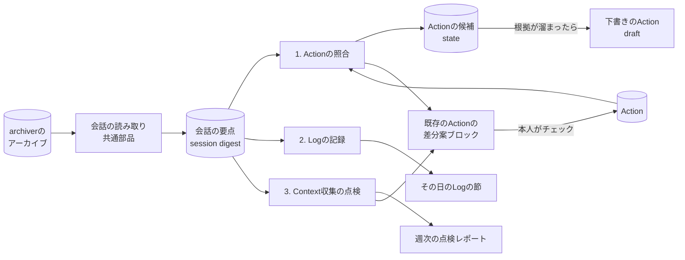

# 役割の作り替え：会話ログから既存ノートへの差分案を作る

> 設計案（2026-11-04作成、2026-11-05更新）。段階0（14節）は0.48.0で実装した（ノートへの書き込みはまだない）。判断を待つ点は [15節](#15-判断を待つ点) にまとめた。
>
> この文書では、利用者ごとに違うフォルダやファイル名を `<actions_dir>`（作業ノート＝Actionの置き場所）、`<logs_dir>`（日次のLogの置き場所）、`<journals_dir>`（テーマごとのノートの置き場所）、`<inbox_dir>`（このCLIの報告の置き場所）と書く。実際の値は設定で決める（[12節](#12-ノートの約束を設定で持つ)）。

## 1. なぜ作り替えるか

- 週・月・年のReview Noteは、質問・学び・判断・未解決・洞察・AI改善案を1つのノートに入れようとして長くなり、何に使うノートなのかが定まらなかった。誤りを避ける指示を重ねた結果、文章も慎重で冗長になった。
- Rawの保管は `tkn-genai-chat-archiver` に移った。会話の検索は `tkn-genai-chat-search` が担う。作業の決定・現状の正本はVaultのActionノートで、各AIが作業中に読み書きする。
- 利用者はノートを書く前にAIへの依頼文を書くことが多い。会話には、日次のLogやActionに書くはずだった内容が多く残っている。
- 一方、Actionは数が多く、進捗の追加・方針の変更・分岐・重複・関係の更新が追いついていない。
- AIが資料を探すときのつまずき（入口の誤り、読み込みの失敗、検索の繰り返し）は、利用者からは見えていない。

そこで、要約ノートを新しく作るのをやめ、**出力先ごとに処理を分け、既存のノートへの差分案を少数出す**役割に変える。

原則：

1. 決定を推測して要約しない。本人の発言・AIの実施記録など、根拠のある差分だけを出す。
2. 1回に出す差分案は少数（既定5件）とし、本人が採否を決める。採用がゼロの種類はやめる。
3. 根拠と確度はJSONの欄で持ち、文章はプログラムが組み立てる。根拠IDが実在するかはプログラムで確かめる。
4. 既存のノートの本文は、本人が採用するまで変えない。変える候補は、ノートの中の決まった1か所（差分案のブロック）にだけ書く。昼間に各AIや本人が書いた内容を上書きしない。
5. 利用者ごとに違うもの（フォルダ、ファイル名、Frontmatterの項目、記録の行の形、生成AIの接続先）は設定で持つ。

## 2. 全体の構成

出力先ごとに置き方を分ける。

- **既存のAction**：本文の先頭に「未確認の差分案」のブロックを置き、変更の候補はそこにだけ書く。本人がチェックした項目だけを、次の実行で所定の場所へ移す。どこが変わる・変わったかは、このブロックで分かる。
- **新しいAction**：日をまたいで根拠が溜まった候補だけを、`<actions_dir>` に下書き（`reviewStatus: draft`）として作る。候補を溜める場所はVaultの外（このCLIのstate）。
- **日次のLog**：その日の会話の記録と、その日に作業したActionへのリンクだけを書く。Actionの候補や修正案は書かない。Actionやタスクは日をまたぐ期間の会話から見えてくるもので、1日1ファイルのLogに書くと、同じ内容が別々の日のLogに散らばるため。



| 処理 | 入力 | 出力 | 実行 | 生成AI |
|---|---|---|---|---|
| 会話の要点（共通） | アーカイブの会話（Codex・Claude Code） | 会話ごとのJSON | 毎日 | 使わない |
| 1. Actionの照合 | 前回以降の会話、対象のAction | 既存のActionの差分案ブロック、下書きのAction | 毎日 | 対応づけの曖昧な分と、差分案の抽出 |
| 2. Logの記録 | 前日の本人の依頼文 | その日のLogの節 | 毎日 | 最初は使わない（5.3節） |
| 3. Context収集の点検 | ツール実行の記録 | 週次の点検レポート、改善案（指定したActionの差分案ブロック） | 数えるのは毎日、レポートは週1回 | つまずきの大きい会話だけ |

## 3. 共通部分：会話の読み取りと「会話の要点」

### 3.1. 読む場所

- 読むのは `tkn-genai-chat-archiver` のアーカイブだけ（Codexの各環境、Claude Code）。アプリの元の保存場所は読まない。根拠IDが、変わらない版を指すようにするため。
- アーカイブの約束（確定したmanifestだけを読む、相対パスごとの最新版を使う、SHA-256を照合する、書き込まない）に従う。
- 使用中の会話はarchiverが見送るため、翌日の実行で取り込まれる。1日の遅れを許す。
- 日時はUTCで記録されることがあるため、設定の時差で現地の日付に直してから使う。

### 3.2. 会話の要点（session digest）

生成AIを使わずに、会話ごとに次をまとめたJSONを作る。3つの処理はこれを読む。

| 欄 | 内容 |
|---|---|
| `sessionRef` | アプリ・取得元ID・セッションID |
| `cwd` / `repo` | 作業フォルダと、その最後のフォルダ名（リポジトリ名）。ドライブ文字の違いやジャンクションは、設定の `path_aliases` で同じものとして扱う |
| `title` | 会話のタイトル（アプリが付けたもの・本人が付けたもの） |
| `kind` | `main`・`subagent`・`review` |
| `userRequests` | 本人の発言（3.3節）。根拠ID・日時・本文・貼り付けかどうか |
| `assistantFinals` | 各ターンの最後のAIの回答。根拠ID・日時・本文（長さを制限） |
| `toolEvents` | ツール実行。根拠ID・日時・ツール名・分類（読む・探す・一覧・編集・実行・Web・Skill・その他）・対象（パス・検索語）・成否・失敗の種類・結果の大きさ |
| `vaultTouches` | 会話中に開いた・変えたVaultのノート（Action・Logなど） |
| `facts` | 機械的に分かる実施の事実（commitのハッシュ、書いたファイル、登録した定期実行など） |
| `coverage` | 読めなかった行、知らない記録の種類の件数 |

置き場所は `<data_root>/digests/`。アーカイブから作り直せるため、消えても困らない。

### 3.3. 「本人の発言」の判定

`決定（本人）` の根拠になるため、ここを厳しくする。

- Codex：`role: user` の発言から、Codexが付け足すAGENTS.mdの指示・環境情報を除く（`tkn-genai-chat-search` と同じ規則）。`review`・`subagent` の会話は対象外。
- Claude Code：`type: user` の発言のうち、次を除く。
  - `<system-reminder>` の部分と、それだけの発言
  - `isMeta`・`isCompactSummary`・`isSidechain` の発言
  - `turnOrigin` が `human` でない発言（例：`sdk`）。別のセッションから渡された依頼文や通知がこれに当たる。古い記録でこの欄がない発言は本人の発言として扱うが、確度を1段下げる
  - ツール結果だけの発言（`tool_result`）
- 貼り付け（`<pasted_content>`）は本人の発言に含める。利用者は依頼文を別の場所で書いて貼ることが多いため。ただし、発言の一部だけが貼り付けで、その部分から決定を引用する場合は確度を下げる（他人の文章やログの可能性があるため）。

### 3.4. 根拠ID

`<app>/<source_id>/<session_id>@<版のSHA-256の先頭12桁>#L<行>` の形とする。

- アーカイブの版は変わらないので、IDから元の行を取り出せる。
- プログラムは、IDの版がアーカイブにあり、SHA-256が一致し、その行が会話の要点の中にあることを確かめる。存在しないIDを含む差分案は捨て、件数を記録する。
- ノートに書く行の「根拠」には `<アプリ名> <セッションID>` だけを書く。版と行は差分案のJSONに残す。

### 3.5. 前回の続きから読む

- 会話ごとに「どの版の何行目まで処理したか」を `state_root` に残す。
- 次の版が前の版への追記（archiverの `previous.relation: appended`）なら、続きだけを読む。書き換え（`rewritten`）なら会話全体を読み直し、出し済みの差分案と重複しないようにする。

### 3.6. Actionの読み取り

- `<actions_dir>` 以下のMarkdownを直接読む（夜間にObsidianを起動しないため）。件数は数千件程度なので、DBや索引は作らない。
- 読むもの（項目名と見出しは設定で決める）：Frontmatter（ID・title・status・更新日時・確認の状態・生成者・関係の項目・任意の `aliases`・`repositories`）、作業の項目（未チェックのチェックボックス）、Notesの記録の行（日付・種類・主体・結論・根拠）、差分案のブロック（4.6節）。
- Notesの根拠にあるセッションIDから、「どの会話がすでにどのActionに記録されたか」の索引を実行のたびに作る。

## 4. 処理1：Actionの照合

### 4.1. 対象

- 会話：前回の実行以降の新しいターン。最初の実行だけ直近14日分。`main` の会話だけを読み、サブエージェントの作業は親の会話の `facts` に含める。
- Action：
  - 段階1では、statusが「作業中」のActionと、直近14日に更新日時が変わったAction
  - 会話中に開かれた・変えられたActionは、statusにかかわらず対象に加える
  - 新しいActionの候補との重複を調べるときは、終了していないAction（下書きを含む）すべてと比べる

### 4.2. 会話とActionの対応づけ

まずプログラムで手がかりを集め、それで決まらない分だけ生成AIに選ばせる。

| 手がかり | 強さ | 内容 |
|---|---|---|
| A. 会話中にActionを開いた・変えた | 強 | `toolEvents` に `<actions_dir>` 以下のパスがある。各AIが作業の始めにActionを読む運用なら、これが主な手がかりになる |
| B. Actionの根拠にこの会話がある | 強 | Notesの根拠にこのセッションIDがある。会話中に書かれた行と重複させないためにも使う |
| C. 本人の発言にActionの名前がある | 強 | WikiLink・ファイル名・title・`aliases` の一致 |
| D. 作業フォルダのリポジトリ名がActionにある | 中 | `repositories` の値、なければtitleに含まれるリポジトリ名。1件だけ一致すれば対応づける |
| E. 言葉の近さ | 弱 | 本人の発言と、title・description・nouns・未チェックの項目との文字n-gramの近さ。上位3件だけを候補にする |

決め方：

1. A・B・Cのどれかがあれば、そのActionに対応づける（複数あれば複数）。
2. なければ、Dが1件だけならそれに対応づける。
3. Dが複数、またはEだけのときは、候補（最大3件）を生成AIに示し、どれか1つか「どれでもない」を選ばせる。候補にないIDは選べない。
4. 「どれでもない」となり、本人の依頼に作業の実体がある会話は、新しいActionの候補に足す（4.7節）。

結果は `links.jsonl` に、手がかりと決め方とともに残す。誤った対応づけを後から調べられるようにするため。

### 4.3. 既存のActionへの差分案の種類

| 種類 | 反映する場所 | 内容 | プログラムの確認 |
|---|---|---|---|
| `decision` | Notesの末尾に1行 | 既定：`- YYYY-MM-DD 決定（本人。<処理名>が抽出）：<結論>。根拠：<アプリ名> <ID>` | 本人の発言からの引用（`userQuote`）が、根拠の発言に文字どおりある |
| `done` | 同上 | 既定：`- YYYY-MM-DD 実施（<AI名>。<処理名>が抽出）：<結論>。根拠：…` | 根拠がツール実行かAIの回答で、`facts` と食い違わない |
| `check` | 同上 | 既定：`- YYYY-MM-DD 確認（本人。<処理名>が抽出）：<結論>。根拠：…` | 本人の発言からの引用がある |
| `status` | Frontmatterのstatus・着手日 | 例：未着手のActionで作業が始まった → 作業中、着手日を設定 | 根拠の会話で、そのActionの作業の実体がある |
| `relation` | 関係の項目 | 例：親のActionへのリンクを足す | 両方のActionが実在する |
| `task` | 作業の項目 | チェックボックスを1つ足す（点検の改善案など。6.3節） | 根拠がある |
| `duplicate`・`split` | 両方のActionのNotes | 重複・分岐の指摘。採用されたら両方に本人の決定の行を足す。statusの変更は別の項目として出す | 両方のActionが実在する |

- 行の形（種類の名前・主体の書き方・区切りの記号）は設定のテンプレートで変えられる。上は同梱する日本語の既定。
- 日付は、根拠の発言の日付（現地時間）とする。実行した日ではない。
- `提案` の行は段階1では作らない。AIの勧めは数が多く、すぐ埋まるため。
- 会話中にAIがすでに書いた行（同じセッションID・同じ種類・近い結論）があれば出さない。

### 4.4. 生成AIへの入力と出力

対応づいたActionごとに1回呼ぶ（そのActionに対応づいた新しいターンをまとめて渡す）。

入力：

- Actionの要約：title・status・未チェックの項目・Notesの最後の10行・差分案のブロックにある未判定の項目
- 対応づいたターン：本人の発言（上限あり）、各ターンの最後のAIの回答（上限あり）、`facts`
- それぞれの根拠ID

出力（JSON。schemaで縛る）：

```json
{
  "proposals": [
    {
      "kind": "decision",
      "actionId": "<noteId>",
      "conclusion": "期間ごとのレビューをやめ、出力先ごとに処理を分ける",
      "evidenceIds": ["claude-code/my-pc-windows/<session-id>@<sha12>#L120"],
      "userQuote": "出力先ごとに処理を分ける",
      "confidence": "high",
      "alreadyRecorded": false
    }
  ],
  "newActionCandidates": [
    {
      "title": "<動詞で終わる短いtitle>",
      "evidenceIds": ["..."],
      "userQuote": "<作業する意思を示す本人の発言>",
      "parentCandidateIds": ["<noteId>"]
    }
  ]
}
```

- `conclusion` は80文字以内、改行なし、句点なし。本人の言葉に近く書かせる。
- 理由や留保の文章は書かせない。確度は `high`・`medium`・`low` の3段階だけ。
- 出力が契約に合わなければ1回だけ直させる。それでも合わなければ捨てて記録する。
- 1回の実行の呼び出し回数に上限を設ける（例：10回）。超えた分は次回に回す。

### 4.5. 並べ方と上限

- 順位：手がかりの強さ × 確度。同じなら `decision` > `done` > `status` > `check` > `relation` > `task` > `duplicate`・`split`。新しいActionの下書きも同じ枠に入れる。
- 1回の実行で新しく出すのは既定5件（ブロックの項目と下書きのActionの合計）。残りはJSONに残す。
- 1つのActionのブロックに置く未判定の項目は既定5件まで。
- 未判定の項目と、判定されていない下書きのActionが合わせて既定10件以上あれば、新しい差分案を出さない。溜まる場所を増やさないため。
- 30日たっても判定のない項目はブロックから外し、「無反応」として数える。外した項目はstateに残し、同じ根拠でまた出すことはしない。

### 4.6. 差分案のブロック（既存のAction）

既存のActionへの変更の候補は、本文の先頭（Frontmatterの直後）に置く1つのcalloutにだけ書く。

```markdown
> [!ai-proposal] 未確認の差分案（<処理名>、2件）本人の判定前。決定として扱わない
> - [ ] Notesに足す：2026-11-04 決定（本人。<処理名>が抽出）：期間ごとのレビューをやめ、出力先ごとに処理を分ける。根拠：Claude Code <session-id>
>     - 根拠：「…出力先ごとに処理を分ける…」（本人、11-04 14:52）／確度：高（会話中にこのActionを開いた。引用が一致）／P-20261105-01
> - [ ] statusを変える：NotStarted → InProgress、startedを 2026-11-03 にする
>     - 根拠：Claude Code <session-id> でこのActionの作業をした（commit 2件）／確度：高／P-20261105-02
```

判定のしかた：

| 本人の操作 | 意味 |
|---|---|
| チェックを付ける | 採用。次の実行で、項目に書いた場所へ移す |
| 内容を書き換えてからチェックを付ける | 修正して採用。書き換えた内容で移す |
| 項目を消す | 却下 |
| 理由を残したいとき：行頭を `- [-]` にし、後ろに理由を書く | 理由付きの却下（`誤り`・`不要`・`重複`・`粒度`・`記録済み`） |
| そのままにする | 未判定（30日で外す） |

ブロックの扱い：

- ブロックの範囲（calloutの行）が、そのActionで「これから変わるかもしれない部分」のすべてになる。採用されて移った内容は、本人がチェックした項目そのものなので、Gitの差分を見なくても何が変わったか分かる。
- 項目は日をまたいで溜まり、同じ内容（同じ種類・近い結論）は1つにまとめる。テーマが何日も続いても、差分案はそのAction1か所に集まる。
- 項目の末尾のID（`P-…`）で、判定と差分案を対応づける。ブロックの形が崩れて読めないときは、ブロックに触らずに報告する。
- 項目がなくなったら、ブロックごと消す。
- calloutの種類名・見出しの文言・置く位置は設定で変えられる。
- Vaultでタスクを集める一覧を使っている場合、ブロックのチェックボックスがそこに集まることがある。必要ならその一覧の条件で除く。

ほかのAIとの約束（Vault側の規則に足す必要がある）：

- `ai-proposal` のブロックの中身は本人の判定前で、決定・現状として扱わない。
- ほかのAIはブロックを書き換えたり消したりしない（本人とこのCLIだけが変える）。

判定待ちのActionの見つけ方：

- ブロックを足したActionは、確認の状態を「未確認」（既定 `unreviewed`）にする。
- 件数で並べたい場合は、Frontmatterに未判定の件数（例：`aiProposals: 2`）を持たせる（13節。任意）。

### 4.7. 新しいAction（下書き）

候補を溜める：

- 既存のActionに対応づかない会話の作業や、`newActionCandidates` は、すぐにはActionにせず、`state_root/action-candidates.json` に溜める。候補ごとに、根拠の会話・日付・`facts`・本人の発言を足していく。
- 次のどれかを満たした候補だけを、下書きのActionにする。
  1. 2日以上の別々の日の会話に出てきた
  2. 作業の実体がある（commit、ファイルの作成、定期実行の登録など）
  3. 本人が会話の中で「やる」「作る」とはっきり言った（引用が発言に文字どおりある）
- 作る前に、終了していないAction（このCLIが作った下書きを含む）と、title・リポジトリ名・`aliases` で比べる。近いものがあれば、新しく作らず、そのActionへの差分案（`relation` や `decision`）に回す。

下書きの形：

- 設定のテンプレート、または設定したコマンド（利用者のVaultのFrontmatter処理など）で作る。ファイル名の形も設定に従う。
- Frontmatter：確認の状態は `draft`、生成者は `<処理名> (<モデル名>)`。statusは事実から決める（作業の実体があれば作業中と着手日、なければ未着手）。親の候補が確かなら関係の項目に入れる。
- 本文：Contextには本人の発言の引用だけを置く（AIの説明文は入れない）。Notesには根拠付きの記録の行を置く。
- 新しいファイル全体が下書きなので、差分案のブロックは使わない。

判定のしかた：

| 本人の操作 | 意味 |
|---|---|
| 確認の状態を `draft` 以外にする | 採用。以後は普通のActionとして扱う |
| ファイルを消す、またはstatusを終了（例：`Closed`）にする | 却下。同じ根拠で作り直さない |
| そのままにする | 未判定。上限（4.5節）に数える |

判定待ちの下書きは、「確認の状態が `draft` で、生成者がこのCLI」という条件の一覧（Obsidian Basesなど）で見つける。

### 4.8. ノートへの書き込み

1. 採用前に変えるのは、既存のActionでは差分案のブロックと、確認の状態・更新日時（・任意の件数の項目）だけ。ブロックの外の本文は、本人が採用した項目を移すときにしか変えない。
2. 採用された項目は、項目に書いた場所へ移す。Notesの行は、Notesの中の最後の記録の行の後に足す（記録の行がなければNotesの最後、成果物の節の前）。移したらブロックから消す。
3. Notesの行以外を変えたとき（status・関係の項目・作業の項目）は、同じ編集で `実施（<処理名>）` の行を足し、変えた場所を書く。
4. 本人が採用した項目を移すときは、確認の状態を変えない（本人が確認済みのため）。ブロックに新しい項目を足したときは「未確認」にする。
5. 書く前に読んだ内容のSHA-256を残す。書く直前に読み直して比べ、変わっていたら計画をやり直す（1回まで）。それでも変わるなら次回に回す。置き換えは一時ファイルからの置き換えで行う。
6. 最後の変更から30分以内のファイルと、直近60分に動いていた会話が開いた・変えたActionは、次回に回す。その会話のAIや本人が書いている最中かもしれないため。
7. 同じセッションIDを根拠にした、同じ種類の近い結論の行がすでにあれば、出さない・移さない。
8. Frontmatterは対象の行だけを書き換える（YAML全体を書き直さない）。改行コードとBOMは元のままにする。
9. 書いた内容を `state_root/applied.jsonl` に残す（ファイル・ID・項目・前後のSHA-256）。commitはしない。
10. この処理は同時に1つしか動かない（ロック）。

### 4.9. 直接書く方式へ移る条件

差分案の種類ごとに判定する。

| 条件 | 内容 |
|---|---|
| 件数 | 判定済みが20件以上、期間が14日以上 |
| 採用率 | そのままの採用が90%以上（無反応も分母に入れる） |
| 誤り | 直近10件に理由「誤り」の却下がない |
| 本人の決定 | 本人が移ると決め、そのことをActionに記録している |

- 直接書く方式では、行をNotesなどの所定の場所に直接書き、行の末尾にブロックID（例：`^gcn-20261105-01`）を付ける。差分案のブロックには「直接書いた行（確認だけ）」としてその行へのリンクを並べ、チェックボックスは付けない。本人が確認したらリンクの項目を消す（確認の状態を `accepted` にしたら、このCLIが消す）。
- このCLIが書いた行は、主体の「<処理名>が抽出」とブロックIDで見分けられる。Gitの差分を見なくても、どの行を書いたかが分かる。
- 直接書いた行を本人が消した・書き換えたことを次回に見つけたら、却下として数える（整形ツールによる空白などの違いは無視する）。14日に2件以上あれば差分案の方式に戻す。
- 止める条件：差分案が5件以上あって2週続けて採用が0件、または判定済み20件で採用率30%未満の種類は出すのをやめ、その旨をActionに記録する。
- `duplicate`・`split`・`status`（終了にするもの）は直接書く方式に移さない（Actionを閉じる判断を含むため）。

### 4.10. 実行のタイミング

毎日、archiverの後（例：archiverが02:00なら04:00）。順番は次のとおり。

1. 各Actionのブロックと下書きのActionから、判定を読む
2. 採用された項目を移す。却下・期限切れを記録する
3. 新しい会話を対応づけ、差分案と候補を作る
4. 条件を満たした候補から下書きのActionを作る
5. ブロックに新しい項目を足す

## 5. 処理2：Logの記録

### 5.1. Logの使い方（前提）

- Logは1日1ファイル（例：`2026-11-04.md`）。その日のファイルがなければ作り、あれば節を足す。1日1ファイルの制限がLogの価値である。
- Logには何を書いてもよく、日単位の受信箱に近い。
- 1つのテーマの記述が長くなるときは、テーマごとのノート（Journal）を使う。
- 実行した内容やActionに関係することは、なるべくActionに書く。最初にLogに書き、後でほかのノートへ移してもよい。

このCLIは、会話を日付で絞り、その日のLogに節を1つ足す。範囲が1日に決まっているので、処理も内容も安定する。Actionの候補や修正案は書かない（2節）。

### 5.2. 節の形

```markdown
## AIとの作業（<処理名>）
<!-- <処理名>:log-section date=2026-11-04 run=20261105T040000+0900 -->

### 依頼と考え

- 09:12 Claude Code「<会話のタイトル>」（[[<Action A>]]）
    - 「期間ごとのレビューは、全方面に対応しようとして長く、何にも特化していない」
- 21:40 Codex「<会話のタイトル>」
    - 「…」
    - 「…」

### 作業したAction

- [[<Action A>]]：会話2件（Claude Code <session-id>、Codex <session-id>）
```

- 「依頼と考え」は、その日の会話を時刻順に並べ、本人の言葉を切り出して置く。Actionに対応づいた会話は、最初の依頼の1行（100文字まで）とActionへのリンクだけにし、詳しい内容はActionの側（差分案）に任せる。Actionに対応づかない会話は、本人の発言をもう少し多く残す（1発言300文字まで）。
- 「作業したAction」は、その日に作業したという事実とリンクだけ。タスクや修正案ではない。Actionの側からは、その日のLogへの逆リンクで作業した日が分かる。
- AIが書いた説明の文は入れない。
- APIキーやトークンらしい文字列は伏せる。長い貼り付け（ログ・コード）は1行の注記に置き換える。
- 見出しの文言と目印のコメントは設定で変えられる。目印のコメントで、このCLIが書いた節を見つける。

### 5.3. 作り方

- 段階3a（生成AIなし）：上の規則で、発言の先頭から決まった長さを切り出す。
- 段階3b（生成AIあり）：生成AIは「どの発言のどこを切り出すか」と「話題の見出し（20文字以内）」だけを返す。切り出した文字列が発言に文字どおりあるかを、プログラムが確かめる。
- 段階4以降の候補：同じテーマの記述が何日も続く場合に、Journalへまとめる候補を出す（置き場所は、そのとき決める）。

### 5.4. 更新と評価

- 前日の分を毎日書く。節は一度書いたら書き換えない。後から同じ日の会話が届いたら、節の末尾に `### 追加（<日時>）` として足す。
- その日のファイルを本人が編集中の可能性があるため、4.8節の書き込み手順（30分の待ち、書く直前の照合）を使う。
- 節を足したら、Logの確認の状態を「未確認」にし、Frontmatterの `actions` に作業したActionへのリンクを足す（13節の項目がある場合）。
- 7日後に、節の項目が残っているか、消されたか、ActionやJournalに移されたかを数え、役に立っているかの目安にする。

## 6. 処理3：Context収集の点検

### 6.1. 生成AIを使わずに数えるもの

会話ごと（サブエージェントを含む）に数え、毎日 `<data_root>/audit/metrics/` に残す。

| 指標 | 内容 |
|---|---|
| 資料を探した回数 | 読む・探す・一覧のツール実行。シェルの `cat`・`rg`・`ls`・`Get-Content` なども分類する |
| 開いた入口 | 最初の数回で開いたファイル（設定した指示ファイル・spec・README・Action） |
| 読み込みの失敗 | ファイルがない・パスの形の誤り・権限・文字コードなど。種類ごと |
| 本人の拒否 | 本人が許可しなかったツール実行。失敗とは別に数える |
| 検索の繰り返し | 同じ検索語・ほぼ同じ検索語の2回目以降 |
| 読み直し | 同じファイルを3回以上読んだ |
| 着くまでの手数 | 最初に編集したファイル、または対応づいたActionを開くまでの、資料を探した回数 |
| 広すぎる走査 | 深さを限らない一覧・検索、切り詰められた大きな結果 |
| Actionの規則の守り方 | 始めにActionを読んだか。commit・ファイル作成などの後にNotesに行を足したか。行の形が規則どおりか |

最後の行は、Actionを作業の決定・現状の正本にする試行の評価に使う（AIごと・週ごとの割合）。

### 6.2. 生成AIで読むもの

- 週1回、つまずきの大きい会話（失敗・繰り返し・手数の多さで点数を付けた上位5件）だけを生成AIに渡す。
- 入力：本人の最初の依頼と、ツール実行の並び（ツール名・対象・成否・失敗の最初の200文字）。
- 出力（JSON）：原因の分類（入口がない・パスの思い込み・名前が紛らわしい・資料が古い・ツールの使い方・環境）、「この入口があれば早く着けた」資料、改善先のファイル（設定の `instruction_files` に一致するファイルから選ぶ）、改善案（120文字以内）、根拠ID。

### 6.3. 出力

- 週次の点検レポートを `<inbox_dir>` に置く。数表はプログラムが作る。
- 改善案は、設定で指定したAction（`audit.target_action`）の差分案のブロックに `task` の項目として出す（週5件まで）。採用されたら、そのActionの作業の項目にチェックボックスとして足し、`実施` の行を書く。指示ファイルそのものは書き換えない。

### 6.4. タイミング

数えるのは毎日、レポートと生成AIは週1回（例：月曜）。

## 7. 既存の期間レビューとprofileの扱い

| 対象 | 扱い |
|---|---|
| 週・月・年のReview Note生成 | `scheduled-run` から外す。`review-notes validate` と既存ノートの表示更新は段階4まで残し、新しい機能は足さない |
| 生成済みのReview Note | 消さない。読む側の約束（Review Note 1.0.0）も段階4まで残す |
| profile `default-jp`・`default-en` | レビュー専用（抽出・統合・校正・比較・修復）。段階4でレビューの実装とともに外す |
| 新しいprofile | 処理ごとに `profiles/<処理>/<言語>/` に `prompt.md`・`output.schema.json`・`template.md`・`profile.json` を置く。読み込み・schemaの照合・cacheの仕組みは今のものを使う。最初は日本語だけ |
| Raw取得（`raw ingest`・`clone`） | archiverに移ったので、段階4で外す |
| Canonical Events・catalog・provenance | 新しい処理は使わない（根拠はアーカイブの版を直接指す）。読む下流が残っていなければ段階4で外す |
| `build-report`（利用量） | 残す。新しい処理の呼び出し回数・費用も記録する |

## 8. 生成AIの接続

- `tkn_genai_bridge` はPythonの依存ライブラリとして、版（commit）を固定して入れる。Bridge CLIの別途のインストールや、Bridgeの共通の設定ファイルには依存しない。
- 接続先とモデルは、このCLIの `config.yaml` のルートの `genai_profiles` に書く。各処理は `genai_profile` で名前を選ぶ。

```yaml
genai_profiles:
  codex-default:
    provider: codex
    model: null          # null：そのCLIの既定のモデル
  claude-default:
    provider: claude-code
    model: null

processes:
  actions:
    genai_profile: claude-default
```

- CLI型の接続先（Codex・Claude Code）は、そのCLIの既存のログインを使う。API型の接続先は、APIキーを取り出す環境変数の名前だけを書き、値は書かない。
- 今の `generation.profiles.<名前>.bridge_profile`（Bridgeの共通の設定を名前で読む方式）は廃止し、移し方を案内する。料金・上限の設定は `genai_profiles` 側に置く。
- テストでは外部へ送信せず、Bridgeのオフライン計画と代わりの応答を使う。

## 9. Claude Codeのログの読み方

- アーカイブ（profile `claude-code`）の `projects/<フォルダ名>/<session-id>.jsonl` を会話、`<session-id>/subagents/agent-*.jsonl` をサブエージェントとして読む。`tool-results/` の長いツール結果は大きさだけを使う。`.orphaned-` を含むファイルは読まない。
- 作業フォルダはフォルダ名から推測せず、記録の `cwd` を使う。

| 記録 | 使うもの |
|---|---|
| `type: user\|assistant` の `message.content` | `text`（本文）、`tool_use`（`id`・`name`・`input`）、`tool_result`（`tool_use_id`・`is_error`・`content`）。`thinking` と画像は使わない |
| 同じ記録の欄 | `timestamp`・`cwd`・`uuid`・`sessionId`・`isSidechain`・`isMeta`・`isCompactSummary`・`turnOrigin`・`promptSource`・`entrypoint` |
| 最上位の `toolUseResult` | ツール結果の構造化された内容。失敗の種類の判定に使う |
| `custom-title`・`ai-title` | タイトル |
| その他の種類（`attachment`・`system`・`api-request` など） | 読まずに種類ごとの件数だけ数える |

- ツール実行は `tool_use.id` と `tool_result.tool_use_id` で組にする。結果のない実行は「結果なし」として数える。
- ツールの分類：`Read` は読む、`Grep`・`Glob` は探す、`Edit`・`Write` は編集、`Bash`・`PowerShell` はコマンドを分けて分類（`cat`・`rg`・`ls`・`Get-Content`・`Select-String` など）、`Skill` はSkillの利用、`WebSearch`・`WebFetch` はWeb、`mcp__*` は名前で分類する。
- Codexでは、`function_call`・`custom_tool_call`（`call_id`・`name`・`arguments`）と `function_call_output`（`call_id`・`output`）を `call_id` で組にする。今の正規化は組にしていないので直す。
- 長いパス（260文字超）に備え、Windowsでは `\\?\` 付きで開く。
- ログの形式はアプリの内部仕様で、版によって変わりうる。知らない形は件数を報告し、黙って捨てない。

## 10. ログの読み取りの共通化

| 案 | 内容 | 長所 | 短所 |
|---|---|---|---|
| A（推奨） | アプリごとのログの読み取りを `tkn-genai-chat-search` のライブラリとして公開し、アーカイブの読み取りを `tkn-genai-chat-archiver` のライブラリとして公開する。このCLIは両方に依存する | 形式の変化への対応が1か所で済む。検索CLIもアーカイブを読めるようになる | リポジトリ間の依存が増え、版を固定して管理する必要がある |
| B | 読み取りだけの小さなライブラリを新しく作り、3つのCLIが使う | 依存の向きが分かりやすい | リポジトリが1つ増える |
| C | このCLIに読み取りを複製する | 独立して動く | 同じ形式の対応を2か所で直すことになる |

Aでの分担：

- archiver：`ArchiveView`（確定したmanifestを読み、相対パスごとの版を並べ、SHA-256を確かめ、展開したバイト列を返す）。読み取り専用。アーカイブの形式の持ち主なので、ここに置く。
- 検索CLI：アプリごとの読み取り（Codex・Claude Code）を、ファイルのバイト列から発言とツール実行の記録を返す関数として公開する。ツール実行は求められたときだけ返し、今の検索の動作は変えない。
- このCLI：上の2つを組み合わせて会話の要点を作る。今の `archive_reader.py`・`chat_logs.py` は移行後に外す。

依存は各リポジトリのcommitかタグで版を固定する（Bridgeと同じ方法）。合成ログのテスト用データを共有する。

## 11. 名前

- `tkn_genai_chat_note_pipeline`（package `tkn_genai_chat_note`、CLI `tkn-genai-chat-note`）に変える。Codex専用でなくなり、archiver・searchと名前がそろう。会話からノート（Action・Log）への差分を作るので `note` は残す。
- 時期：ノートに `<処理名>` 入りの行を初めて書く前（段階0）。後から変えると、Notesに古い処理名が残るため。
- 既存の保存先の所有の印（storage 5）は変えない。設定ファイルの場所は新しい名前に移し、移す手順を用意する。

## 12. ノートの約束を設定で持つ

利用者ごとに違うものは、すべて `config.yaml` の `vault` 節に置く。同梱するのは日本語の既定値と、その説明だけ。利用者の実際の値はリポジトリの外（利用者の設定フォルダ）に置き、commitしない。

| 設定 | 内容 | 例 |
|---|---|---|
| `root` | Vaultの場所 | `C:/path/to/vault` |
| `actions.dir`・`actions.filename` | Actionの置き場所と、新しく作るときのファイル名の形 | `actions`、`"{created:%Y%m%d} {title}.md"` |
| `actions.frontmatter` | 項目名の読み替え（ID・title・status・着手日・更新日時・確認の状態・生成者・関係・`aliases`・`repositories`・未判定の件数） | `id: noteId` |
| `actions.statuses` | 「作業中」「未着手」「終了」などに当たる値 | `in_progress: [InProgress]`、`closed: [Completed, Done, Closed]` |
| `actions.sections` | Notes・作業の項目・成果物の節を見つける見出しの正規表現 | `notes: "^##\\s+(\\d+\\.\\s*)?Notes"` |
| `actions.record_line` | 記録の行のテンプレートと、読み取りの正規表現。種類・主体の呼び名 | 4.3節の既定 |
| `actions.proposal_block` | 差分案のブロックのcalloutの種類名・見出し・置く位置・1つのActionの上限 | `callout: ai-proposal`、`position: body-start`、`max_items: 5` |
| `actions.candidates` | 下書きにする条件（日数・作業の実体・本人の明言） | `min_days: 2` |
| `actions.draft` | 下書きの確認の状態の値と、生成者の書き方 | `review_status: draft`、`generator: "{processor} ({model})"` |
| `logs.dir`・`logs.filename`・`logs.recognize` | 日次のLogの置き場所、新しく作るときのファイル名、既存として認める別の形 | `logs/{date:%Y}`、`"{date:%Y-%m-%d}.md"`、`["{date:%Y%m%d}.md"]` |
| `logs.section` | このCLIの節の見出しと目印 | `"## AIとの作業（{processor}）"` |
| `journals.dir` | テーマごとのノートの置き場所（段階4以降） | `journals/{date:%Y}` |
| `new_note` | 新しいノートの作り方：同梱のテンプレート、または利用者が指定するコマンド | `command: ["node", "<vault>/path/to/frontmatter-cli", "create", ...]` |
| `review_status` | 確認の状態の項目名と値 | `key: reviewStatus`、`unreviewed: unreviewed`、`accepted: accepted` |
| `inbox_dir` | 週次レポートの置き場所 | `inbox/ai/genai-chat-note` |
| `instruction_files` | 点検で改善先にする指示ファイルのglob | `["**/AGENTS.md", "**/CLAUDE.md", "**/SKILL.md", "specs/**/*.md"]` |
| `audit.target_action` | 点検の改善案を差分案として出すAction | `"<Actionのファイル名>"` |

ほかに、`archives`（読むアーカイブ）、`path_aliases`、`utc_offset_minutes`、`language`、`genai_profiles` も設定で持つ。

### 12.1. 公開リポジトリとしての汎用性

設定で持てば、ほかの利用者・環境でも使える。privateにする必要はないと考える。ただし、次の前提は一般的でないため、READMEに明記する。

- 「作業ノートのNotesに、日付・種類・主体・根拠付きの記録の行を残す」という運用を前提にする。この運用をしない人には、処理1の価値が小さい。
- 差分案のブロックはObsidianのcalloutの書き方を使う。ほかのMarkdownの道具では、ただの引用として見える。
- `tkn-genai-chat-archiver` のアーカイブが必要。
- CodexとClaude Codeのログの内部形式に依存する（どの利用者にも共通の制約）。
- 最初は日本語のprofileと既定値だけを同梱する。

公開に向かない作りになるのは、利用者のVaultの固定のパスや、利用者のVaultの中のスクリプトを、コードやテストに直接書く場合。新しいノートの作成も設定のコマンドで呼ぶ形にして避ける。

## 13. Frontmatterへの追加の案（Vault側）

このCLIはこれらの項目がなくても動き、あれば使う（項目名は12節の設定で読み替える）。

| ノート | 項目 | 用途 |
|---|---|---|
| Action | `aliases` | 会話で使う短い呼び名。手がかりC（4.2節）で使う。Obsidianの標準の項目 |
| Action | `repositories` | 作業するリポジトリの名前（フォルダ名。絶対パスにしない）。手がかりDを、titleの文字列に頼らずに使える |
| Action | `aiProposals` | 差分案のブロックの未判定の件数。判定待ちのActionを件数で並べる。このCLIが書く |
| Log | `actions` | その日に作業したActionへのリンク。Actionの側からその日のLogを辿れる。このCLIが節を足すときに追加する |
| Log | `reviewStatus` | AIや処理が節を足したら `unreviewed`。本人が確認したら `accepted`。Actionと同じ意味 |

下書きのActionは、既存の `reviewStatus: draft` と `generator` で区別するので、新しい項目は要らない。

勧めないもの：会話のセッションIDの一覧（増え続けるため。根拠はNotesの行が持つ）、最終の作業日（Notesの行から求められるため）。

## 14. 段階的な移行

| 段階 | 内容 | ノートへの書き込み | 生成AI | 次へ進む目安 |
|---|---|---|---|---|
| 0. 準備 | 名前を変える。`scheduled-run` からレビューを外す。生成AIの接続を `genai_profiles` に移す。共通の読み取り（Codex・Claude Code）と会話の要点。手がかりA〜Dだけの対応づけを直近14日で試し、レポートにする | なし | なし | 対応づけの結果を本人が見て、取りこぼし・誤りが許せる範囲 |
| 1. Actionの照合 | 4節。始める前に、Vault側の規則に差分案のブロックの約束（4.6節）を足す。対象は作業中と直近14日に更新されたAction。1日5件、未判定10件で止める | 既存のActionのブロック、下書きのAction、採用分の移動 | 使う | 2〜4週の採用率（4.9節） |
| 2. Context収集の点検 | 6.1節の数え上げと週次レポート。Actionの試行の評価の数字。つまずきの大きい会話の分析（6.2節）は、数え上げが役立つと分かってから | 指定したActionのブロック | 後半から | レポートが改善に使われたか |
| 3. Logの記録 | 5節。3a（生成AIなし）→ 3b | その日のLogの節 | 3bから | 項目が残る・移される割合 |
| 4. 片付けと直接書く方式 | 条件を満たした種類から直接書く方式へ。対象のActionを広げる（長く更新のないActionの保留・終了の差分案など）。Journalへまとめる候補。レビュー・Raw取得・旧profileを外し、版を上げる | 種類ごと | 使う | — |

## 15. 判断を待つ点

各項目の推奨と、本人が決めた点は、作業記録（リポジトリ外）の一覧にある。2026-11-05時点で残っているのは次のとおり。

1. Vault側の規則に足す、差分案のブロックの約束（4.6節。段階1の前に必要）。
2. 新しいActionの候補を下書きにする条件の値（4.7節）。
3. 判定のない項目を外すまでの日数（4.5節。仮に30日）。
4. 直接書く方式へ移る条件と、止める条件の値（段階1の結果を見て決める）。
5. ~~ログの読み取りの共通化の方式（10節）~~ 案Aに決まった（2026-11-05）。
6. 処理ごとの生成AIの接続先。
7. 期間レビューのコードとprofileを外す時期。
8. 点検の改善案を出すAction（6.3節）。
9. Frontmatterに足す項目（13節）と、Vault側の仕様・schemaの更新。
